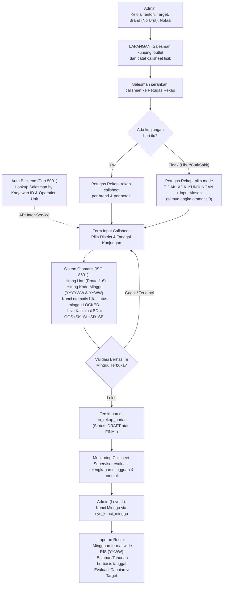
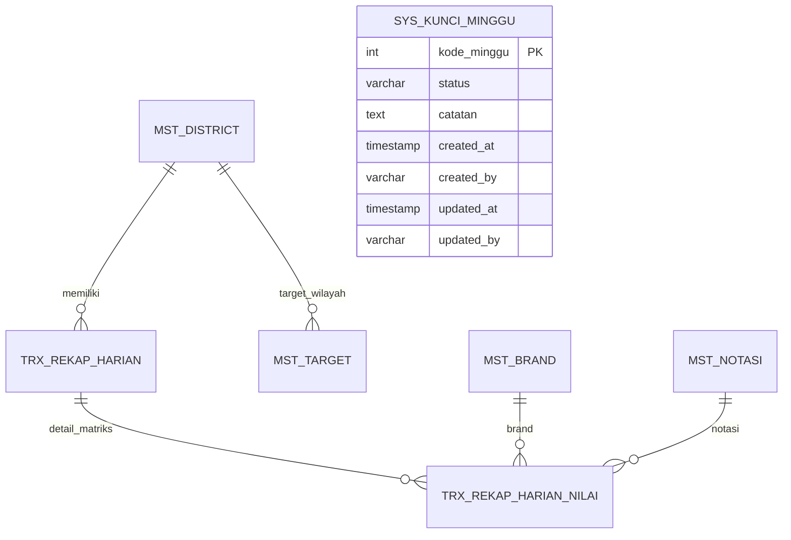

# Rancangan Sistem Inputan RIS (Rekap Callsheet Harian → Laporan Mingguan)

**Dokumen Spesifikasi & Kondisi Sistem Terkini (Revisi 6 - Oktober 2026)**  
Berdasarkan `SAMPLE_RIS.xlsx`, keputusan desain arsitektur HSERA Platform, serta implementasi riil pada backend `hsera-salesmanship-backend` dan frontend `hsera-dashboard`. Input dilakukan **global per Salesman per hari** (rekap callsheet), tanpa master outlet.

**Ringkasan Evolusi Rancangan:**
- **Revisi 3 → 4:** `mst_operation_unit` dan `mst_periode` dihapus; aturan minggu dikunci ke **ISO 8601** dan dihitung database; ditambah status **TIDAK_ADA_KUNJUNGAN**; laporan bulanan/tahunan berbasis tanggal.
- **Revisi 4 → 5:** `mst_notasi` dirapikan (`level_input` dipisah tegas dari `kelompok_tampil`); No Urut brand dan notasi diatur Admin; isolasi multi-tenant via Operation Unit scoping (**FR-20**).
- **Revisi 5 → 6 (Kondisi Saat Ini):** 
  1. Penyelarasan skema database PostgreSQL menggunakan **Prisma ORM** dengan tipe Primary Key **UUID**.
  2. Penambahan kolom agregasi **`bd_outlet`** pada tabel `trx_rekap_harian`.
  3. Standardisasi 6 Kategori Produk Brand: **`SKM FF`**, **`SKM LTLN`**, **`SKT`**, **`SPM`**, **`SPT`**, **`SKTF`**.
  4. Penyederhanaan notasi Face Up dari 2 sub-kolom menjadi 1 kolom terpadu: **`FACE_UP`**.
  5. Antarmuka Manajemen No Urut Brand modern: form create/edit brand men-disable input No Urut (`read-only`), digantikan dengan tombol khusus **"Update No Urut"** sebelum tombol tambah yang membuka Form Drawer bermodel **Quick Stok Opname** untuk update urutan secara massal/simultan (`PUT /api/salesmanship/brands/reorder`).
  6. Pendaftaran rute dan menu ACL pada `hsera-dashboard`: Menu Master Brand (`0877d32e-6e03-4d0c-be8a-dfeec396c3d8`), Teritori Management, Setup Target, Form Callsheet, dan Monitoring Callsheet.

---

## 1. Hasil Analisis Data Sample

### 1.1 Struktur File Sample

| Item | Temuan |
| --- | --- |
| Ukuran | 3.816 baris × 36 kolom, 1 sheet, tanpa formula |
| Kolom dimensi | LOCATION, DISTRICT, SUBID, ROUTE, STATUS_DISTRICT, TIPE_LOCATION, KATEGORY, NOTASI |
| Kolom nilai | 28 kolom minggu berformat **YYWW** (1734 = 2017 minggu 34 … 1752, 1801 … 1809) |
| Grain baris | 1 baris = District × Route (hari) × Brand × Notasi: 212 kombinasi × 18 notasi |
| Format | **Wide**: minggu menjadi kolom, sehingga database memakai bentuk long (ternormalisasi) |

### 1.2 Verifikasi Definisi Terhadap Data

| Pengujian | Hasil |
| --- | --- |
| BD = OOS + SK + SL + SD + SB | **Cocok 100%** dari 3.784 baris aktif |
| OOS + SK + SL + BPJ + SB + TL + SD = Total Outlet | **Cocok 96%** |
| Total EC ≤ Total Outlet | 100% |
| Outlet Face Up ≤ QTY Face up | 100% |
| Stock ≥ SK + SL + SB + SD (konsisten dengan "ada 1 pack = BD") | 97% |
| Stock ≥ BD (BD termasuk OOS) | 94% |

**7 status (OOS, SK, SL, BPJ, SB, TL, SD) saling eksklusif**: setiap outlet pada satu brand hanya punya satu status. BD adalah angka turunan, sehingga tidak boleh dijumlahkan bersama status lain.

**Selisih 4% (153 baris):** 129 baris ada di minggu 1744, saat angka melonjak hampir dua kali lipat (56 vs sekitar 28-33). Itu mengindikasikan hitung ganda saat rekap manual. Sistem baru mencegahnya lewat validasi dan batas satu rekap per Salesman per hari.

### 1.3 Temuan Lain

- Angka di Excel tersimpan sebagai teks.
- **Minggu 1740 nol total**, minggu 1735 parsial (Total Outlet 275 vs ribuan di minggu lain).
- Route 6 (Sabtu) kosong di minggu akhir, dan route 3 (Rabu) di district 002 kosong di minggu 1746.
- Total Outlet di sample (sekitar 26-39 hari biasa, sekitar 18 Sabtu) lebih kecil dari target kunjungan 40 dan 20, dan sama dengan jumlah 7 status. Jadi **di sample Total Outlet adalah realisasi kunjungan, bukan target**. Di sistem baru target dan realisasi dipisah tegas.
- Kolom minggu di sample memakai kode 4 digit **YYWW**. Pergantian tahun (1752 → 1801) membuktikan bahwa urutan minggu tidak boleh dibuat dengan menambah 1 pada kode.

---

## 2. Istilah dan Pemetaan ke Sistem

| Di sample | Di sistem saat ini |
| --- | --- |
| LOCATION | **Operation Unit (Unit Operasi)**: mengikuti **role management framework** `hsera-auth-backend`, tanpa tabel master lokal. Disimpan sebagai kode teks `ou_kode` di district, disalin ke rekap harian, dan dipakai membatasi hak akses data |
| DISTRICT | **Teritori Management**: kode wilayah milik satu Salesman (`mst_district`), tanpa nama district (`ou_kode` + `kode` unik) |
| ROUTE | **Hari Kunjungan**: 1 Senin … 6 Sabtu, dihitung otomatis dari **tanggal input** (aturan ISO 8601, tidak ada tabel route) |
| KATEGORY | **Kategori Produk Brand**: Disepakati terdiri dari 6 kategori industri: **SKM FF**, **SKM LTLN**, **SKT**, **SPM**, **SPT**, **SKTF** |
| NOTASI | **Katalog Data yang Diinput** (`mst_notasi`) |
| Kolom 1734, 1735 … | Minggu **ISO 8601**, dihitung otomatis dari tanggal; disimpan integer 6 digit `YYYYWW` (`202634`), ditampilkan 4 digit `YYWW` (`2634`) |
| STATUS_DISTRICT | Kolom standar `status` (AKTIF/NONAKTIF) di `mst_district` |
| TIPE_LOCATION | Dihapus (tidak relevan) |
| SUBID | Dihapus (kosong di sample) |

### Katalog Notasi Riil Sistem

Setiap notasi memiliki dua atribut pembeda:
- **Level** (`level_input`): tempat nilai diinput dan disimpan (`BRAND`, `HARIAN`, `TURUNAN`, `TARGET`).
- **Kelompok tampil** (`kelompok_tampil`): pengelompokan visual header pada Form Grid Callsheet dan Laporan (`STATUS`, `KUANTITAS`, `FACEUP`, `HARIAN`).

| Level | Kelompok tampil | Kode Notasi | Keterangan & Satuan | Tempat Penyimpanan |
| --- | --- | --- | --- | --- |
| `BRAND` | `STATUS` | `OOS` | Out Of Stock (Outlet) | `trx_rekap_harian_nilai` |
| `BRAND` | `STATUS` | `SK` | Stock Kecil / 1-3 slop (Outlet) | `trx_rekap_harian_nilai` |
| `BRAND` | `STATUS` | `SL` | Stock Lebih / > 3 slop (Outlet) | `trx_rekap_harian_nilai` |
| `BRAND` | `STATUS` | `SD` | Stock Display / Etalase (Outlet) | `trx_rekap_harian_nilai` |
| `BRAND` | `STATUS` | `SB` | Stock Box (Outlet) | `trx_rekap_harian_nilai` |
| `TURUNAN` | `STATUS` | `BD` | Brand Distribution = OOS+SK+SL+SD+SB (Outlet). Otomatis dihitung live (Read-only) | Dihitung sistem / kolom `bd_outlet` |
| `BRAND` | `STATUS` | `TL` | Total Layanan Kunjungan (Outlet) | `trx_rekap_harian_nilai` |
| `BRAND` | `STATUS` | `BPJ` | Brand Penjualan / EC Brand (Outlet) | `trx_rekap_harian_nilai` |
| `BRAND` | `KUANTITAS` | `STOCK` | Stock Outlet (Qty: Bks/Slop) | `trx_rekap_harian_nilai` |
| `BRAND` | `KUANTITAS` | `BUY` | Pembelian Outlet (Qty: Bks/Slop) | `trx_rekap_harian_nilai` |
| `BRAND` | `FACEUP` | `FACE_UP` | Face Up Display Produk (Qty) | `trx_rekap_harian_nilai` |
| `HARIAN` | `HARIAN` | `TOTAL_KUNJUNGAN` | Realisasi Kunjungan Harian (Outlet) | Kolom `jumlah_kunjungan` di `trx_rekap_harian` |
| `HARIAN` | `HARIAN` | `TOTAL_EC` | Total Effective Call Harian (Outlet) | Kolom `total_ec` di `trx_rekap_harian` |
| `HARIAN` | `HARIAN` | `VOLUME_GG` | Total Volume GG Harian (Qty) | Kolom `volume_gg` di `trx_rekap_harian` |
| `TARGET` | `HARIAN` | `TOTAL_OUTLET` | Target Kunjungan Harian (Outlet) | Diambil dari `mst_target` (jenis: KUNJUNGAN) |

---

## 3. Proses Bisnis & Integrasi Antar-Layanan

### 3.1 Peran dan Hak Akses (Matrix ACL Framework)

| Peran | Menu Teritori (`...45cf`) | Menu Target (`...e864`) | Menu Brand (`...c3d8`) | Menu Callsheet (`...4e1e`) | Menu Monitoring (`...86d6`) |
| :--- | :---: | :---: | :---: | :---: | :---: |
| **Super Admin / HO Admin** | Level 4 (Full) | Level 4 (Full) | Level 4 (Full) | Level 4 (Full) | Level 4 (Kunci & Buka Minggu) |
| **Petugas Rekap Cabang** | Level 1 (Read) | Level 1 (Read) | Level 1 (Read) | Level 3 (Input & Edit Draft) | Level 1 (Cek Kelengkapan Cabang) |
| **Supervisor Cabang** | Level 1 (Read) | Level 1 (Read) | Level 1 (Read) | Level 1 (Review) | Level 1 (Review Kelengkapan & Anomali) |
| **Manajer / Viewer** | Level 1 (Read) | Level 1 (Read) | Level 1 (Read) | Level 1 (Read) | Level 1 (Laporan & Capaian vs Target) |

- **Salesman** tidak memiliki akun login ke sistem. Identitas Salesman (NIK & Nama Lengkap) diperoleh melalui integrasi inter-service ke `hsera-auth-backend`.
- **Unit Operasi (Operation Unit)** membatasi akses: pengguna cabang otomatis terisolasi hanya pada data teritori dan callsheet di unit perannya (`ou_kode`).

### 3.2 Diagram Alur Transaksi Callsheet

### 3.3 Aturan Kalender & Periode Kerja

1. **Standar Kalender ISO 8601**:
   - Minggu dimulai hari **Senin** (1) s/d **Minggu** (7). Hari kerja operasional adalah Senin s/d Sabtu (Route 1-6). Input pada hari Minggu otomatis ditolak (`400 Bad Request`).
   - Minggu 1 dalam setahun adalah minggu yang memuat hari Kamis pertama tahun tersebut.
   - Tahun 2026 memiliki 53 minggu (contoh minggu penutup: `202653` / `2653`).
2. **Kunci Minggu (`sys_kunci_minggu`)**:
   - Penguncian dilakukan per kode minggu (`kode_minggu`). Baris berstatus `AKTIF` mengunci seluruh transaksi Senin-Sabtu pada minggu tersebut.
   - Jika diperlukan koreksi pasca-tutup buku, Admin (Level 4) dapat membuka kunci (`status = NONAKTIF`) dengan mencantumkan alasan pembukaan audit log.

---

## 4. Kebutuhan Sistem & Antarmuka

### 4.1 Modul Fungsional di Frontend (`hsera-dashboard`)

1. **Master Brand** (`/master/brand`, Menu ID: `0877d32e-6e03-4d0c-be8a-dfeec396c3d8`):
   - CRUD data master produk brand.
   - Pilihan Kategori: `SKM FF`, `SKM LTLN`, `SKT`, `SPM`, `SPT`, `SKTF`.
   - **Form Create/Edit Brand**: Input Nomor Urut dalam keadaan **disabled (read-only)**.
   - **Tombol Khusus "Update No Urut"**: Diletakkan sebelum tombol "Tambah Brand", membuka Form Drawer bergaya **Quick Stok Opname** untuk update urutan seluruh brand secara simultan/batch (`PUT /api/salesmanship/brands/reorder`).
2. **Teritori Management** (`/salesmanship/territory`, Menu ID: `f054f502-72d0-47fb-919d-4de7122145cf`):
   - Kelola kode wilayah/district per Operation Unit beserta penugasan Salesman (NIK/Karyawan ID).
3. **Setup Target** (`/salesmanship/target`, Menu ID: `f4fda652-4730-4e12-ac08-7a4d1ab2e864`):
   - Konfigurasi target untuk 5 dimensi: `KUNJUNGAN`, `BD`, `EC`, `FACEUP`, `VOLUME`.
   - Berlaku global, per district, atau per hari kunjungan dengan tanggal efektivitas.
4. **Form Callsheet** (`/salesmanship/callsheet`, Menu ID: `de9ab023-de01-4545-82ad-968e50b24e1e`):
   - Grid matriks interaktif Brand × Notasi.
   - Live kalkulasi auto-sum kolom `BD = OOS + SK + SL + SD + SB`.
   - Saklar mode *Tidak Ada Kunjungan* + alasan wajib.
   - Shortcut keyboard (`Tab`, `Enter`, `Ctrl+S`).
5. **Monitoring Callsheet** (`/salesmanship/monitoring`, Menu ID: `2cc8cdbd-c155-48fc-a5e5-f72dafab86d6`):
   - Matriks kelengkapan input district Senin-Sabtu minggu berjalan.
   - Kendali Kunci dan Buka Kunci Minggu (`sys_kunci_minggu`).
   - Laporan RIS Mingguan (Format Wide YYWW) dan Export Excel.
6. **Laporan Mingguan Per District (Weekly RIS Report)** (`/salesmanship/report/weekly-district`, Menu ID: `5db9ab11-5554-40bf-8d10-8aa71ca9ede9`):
   - Rekap analitik performa teritori mingguan (Kunjungan vs target, Callmade EC, BD Outlet, Volume Pk, Territory Reach Index).
   - Grafik ritase harian Senin s/d Sabtu.
   - Matriks distribusi produk dinamis ditarik dari `mst_brand` aktif terurut (`urutan ASC`), persentase notasi dihitung terhadap kunjungan mingguan, rata-rata stok/pembelian (`pck`), total volume (`pk`), dan baris ringkasan total.
   - Filter cerdas: Dropdown Minggu ISO dinamis (format `YYWW - Tanggal`, auto-detect minggu `2643` dst, default minggu ini), isolasi Operation Unit (OU) berbasis role, filter district, dan kategori brand.
   - Ekspor Excel (CSV) dan format Cetak ramah kertas.

---

## 5. Desain Database Fisik (PostgreSQL via Prisma ORM)

### 5.1 Diagram Hubungan Entitas (ERD)

### 5.2 Skema Tabel Master

#### `mst_district` (Teritori Management)
| Kolom | Tipe Data | Keterangan |
| :--- | :--- | :--- |
| `id` | UUID PK (`default(uuid())`) | Primary Key unik teritori |
| `ou_kode` | VARCHAR(20), NOT NULL | Kode Unit Operasi dari auth backend |
| `kode` | VARCHAR(10), NOT NULL | Kode wilayah (misal: '001', '002') |
| `karyawan_id` | VARCHAR(50), NOT NULL | NIK / Karyawan ID Salesman penanggung jawab |
| `status` | VARCHAR(10), DEFAULT 'AKTIF' | Status record (`AKTIF` / `NONAKTIF`) |
| `created_at` / `created_by` | TIMESTAMP(6) / VARCHAR(50) | Jejak audit pembuat |
| `updated_at` / `updated_by` | TIMESTAMP(6) / VARCHAR(50) | Jejak audit pengubah |
| **Constraint** | `UNIQUE (ou_kode, kode)` | Kode district unik di dalam satu Unit Operasi |

#### `mst_brand` (Katalog Produk Brand)
| Kolom | Tipe Data | Keterangan |
| :--- | :--- | :--- |
| `id` | UUID PK (`default(uuid())`) | Primary Key unik brand |
| `kode` | VARCHAR(20), UNIQUE, NOT NULL | Kode brand unik (misal: `GG_FILTER`, `HSB20`) |
| `nama` | VARCHAR(100), NOT NULL | Nama lengkap produk brand |
| `kategori` | VARCHAR(20), NOT NULL | **`SKM FF`**, **`SKM LTLN`**, **`SKT`**, **`SPM`**, **`SPT`**, **`SKTF`** |
| `urutan` | INT, NOT NULL, DEFAULT 1 | No Urut prioritas tampilan di form grid & laporan |
| `status` | VARCHAR(10), DEFAULT 'AKTIF' | Status aktif (`AKTIF` / `NONAKTIF`) |
| `created_at` / `created_by` | TIMESTAMP(6) / VARCHAR(50) | Jejak audit pembuat |
| `updated_at` / `updated_by` | TIMESTAMP(6) / VARCHAR(50) | Jejak audit pengubah |

#### `mst_notasi` (Katalog Notasi Input & Header)
| Kolom | Tipe Data | Keterangan |
| :--- | :--- | :--- |
| `id` | UUID PK (`default(uuid())`) | Primary Key unik notasi |
| `kode` | VARCHAR(50), UNIQUE, NOT NULL | Kode notasi: `OOS`, `SK`, `SL`, `SD`, `SB`, `BD`, `TL`, `BPJ`, `STOCK`, `BUY`, `FACE_UP` |
| `nama` | VARCHAR(150), NOT NULL | Deskripsi lengkap notasi |
| `level_input` | VARCHAR(20), NOT NULL | `BRAND`, `HARIAN`, `TURUNAN`, `TARGET` |
| `kelompok_tampil` | VARCHAR(20), NULL | `STATUS`, `KUANTITAS`, `FACEUP`, `HARIAN` |
| `rumus` | VARCHAR(200), NULL | Rumus hitung (khusus BD: `'OOS+SK+SL+SD+SB'`) |
| `satuan` | VARCHAR(20), NOT NULL | Satuan unit: `OUTLET`, `QTY` |
| `urutan` | INT, NOT NULL, DEFAULT 1 | Urutan kolom di dalam kelompok tampil |
| `status` | VARCHAR(10), DEFAULT 'AKTIF' | Status record (`AKTIF` / `NONAKTIF`) |
| `created_at` / `created_by` | TIMESTAMP(6) / VARCHAR(50) | Jejak audit pembuat |
| `updated_at` / `updated_by` | TIMESTAMP(6) / VARCHAR(50) | Jejak audit pengubah |

#### `mst_target` (Konfigurasi Target Kinerja)
| Kolom | Tipe Data | Keterangan |
| :--- | :--- | :--- |
| `id` | UUID PK (`default(uuid())`) | Primary Key target |
| `jenis_target` | VARCHAR(20), NOT NULL | `KUNJUNGAN`, `BD`, `EC`, `FACEUP`, `VOLUME` |
| `district_id` | UUID NULL (FK -> mst_district) | NULL jika berlaku untuk semua district |
| `hari_kunjungan` | SMALLINT NULL | 1..6 (Senin..Sabtu), NULL jika berlaku semua hari |
| `nilai` | DECIMAL(14,2), NOT NULL | Angka target kinerja |
| `berlaku_dari` | DATE, NOT NULL | Tanggal awal efektivitas target |
| `berlaku_sampai` | DATE NULL | Tanggal akhir efektivitas (NULL jika tanpa batas) |
| `status` | VARCHAR(10), DEFAULT 'AKTIF' | Status record (`AKTIF` / `NONAKTIF`) |
| `created_at` / `created_by` | TIMESTAMP(6) / VARCHAR(50) | Jejak audit pembuat |
| `updated_at` / `updated_by` | TIMESTAMP(6) / VARCHAR(50) | Jejak audit pengubah |

---

### 5.3 Skema Tabel Transaksi & Kontrol Sistem

#### `trx_rekap_harian` (Transaksi Callsheet Harian)
| Kolom | Tipe Data | Keterangan |
| :--- | :--- | :--- |
| `id` | UUID PK (`default(uuid())`) | Primary Key transaksi callsheet |
| `district_id` | UUID, NOT NULL (FK -> mst_district) | Relasi ke district yang dikunjungi |
| `tgl_kunjungan` | DATE, NOT NULL | Tanggal kunjungan (Senin-Sabtu) |
| `hari_kunjungan` | SMALLINT, NOT NULL | Hari 1..6 (1=Senin s/d 6=Sabtu, ISO 8601) |
| `kode_minggu` | INT, NOT NULL | Kode minggu integer 6 digit (contoh `202642`) |
| `karyawan_id` | VARCHAR(50), NOT NULL | Snapshot NIK Salesman saat callsheet dibuat |
| `ou_kode` | VARCHAR(20), NOT NULL | Snapshot kode Unit Operasi saat dibuat |
| `jenis_rekap` | VARCHAR(30), DEFAULT 'NORMAL' | `NORMAL` atau `TIDAK_ADA_KUNJUNGAN` |
| `alasan` | VARCHAR(150), NULL | Wajib diisi bila `TIDAK_ADA_KUNJUNGAN` |
| `jumlah_kunjungan` | INT, DEFAULT 0 | Realisasi jumlah outlet yang dikunjungi |
| `total_ec` | INT, DEFAULT 0 | Realisasi Effective Call (outlet ada nota beli) |
| `bd_outlet` | INT, DEFAULT 0 | Total outlet yang memiliki Brand Distribution |
| `volume_gg` | DECIMAL(14,2), NULL | Realisasi volume produk GG (batang/bungkus) |
| `status_rekap` | VARCHAR(20), DEFAULT 'DRAFT' | Siklus lembar: `DRAFT` atau `FINAL` |
| `status` | VARCHAR(10), DEFAULT 'AKTIF' | `AKTIF` atau `NONAKTIF` (soft-delete) |
| `catatan` | TEXT, NULL | Catatan opsional dari petugas rekap |
| `created_at` / `created_by` | TIMESTAMP(6) / VARCHAR(50) | Jejak audit penginput pertama |
| `updated_at` / `updated_by` | TIMESTAMP(6) / VARCHAR(50) | Jejak audit pengubah terakhir |
| **Constraint** | `UNIQUE (district_id, tgl_kunjungan)` | Maksimal 1 rekap aktif per district per hari |

#### `trx_rekap_harian_nilai` (Detail Matriks Brand × Notasi)
| Kolom | Tipe Data | Keterangan |
| :--- | :--- | :--- |
| `id` | UUID PK (`default(uuid())`) | Primary Key sel nilai |
| `rekap_id` | UUID, NOT NULL (FK -> trx_rekap_harian) | Relasi ke rekap harian (Cascade Delete) |
| `brand_id` | UUID, NOT NULL (FK -> mst_brand) | Relasi ke master brand |
| `notasi_id` | UUID, NOT NULL (FK -> mst_notasi) | Relasi ke notasi tingkat BRAND |
| `nilai` | DECIMAL(14,2), NOT NULL, DEFAULT 0 | Nilai capaian matriks callsheet |
| `status` | VARCHAR(10), DEFAULT 'AKTIF' | `AKTIF` atau `NONAKTIF` |
| `created_at` / `created_by` | TIMESTAMP(6) / VARCHAR(50) | Jejak audit pembuat |
| `updated_at` / `updated_by` | TIMESTAMP(6) / VARCHAR(50) | Jejak audit pengubah |
| **Constraint** | `UNIQUE (rekap_id, brand_id, notasi_id)` | Satu nilai per kombinasi brand dan notasi |

#### `sys_kunci_minggu` (Kontrol Tutup Buku Mingguan)
| Kolom | Tipe Data | Keterangan |
| :--- | :--- | :--- |
| `kode_minggu` | INT PK | Kode minggu ISO 6 digit `YYYYWW` (`202642`) |
| `status` | VARCHAR(10), NOT NULL, DEFAULT 'AKTIF' | `AKTIF` = Minggu Terkunci; `NONAKTIF` = Kunci Dibuka |
| `catatan` | TEXT, NULL | Alasan pembukaan kunci untuk keperluan audit |
| `created_at` / `created_by` | TIMESTAMP(6) / VARCHAR(50) | Waktu & identitas Admin yang mengunci |
| `updated_at` / `updated_by` | TIMESTAMP(6) / VARCHAR(50) | Waktu & identitas Admin yang membuka/mengubah |

---

## 6. Daftar Kontrak REST API Backend (`hsera-salesmanship-backend` :5003)

Seluruh endpoint dilindungi oleh `AuthMiddleware` (verifikasi Bearer Token JWT) dan `AclMiddleware` berbasis Level Hak Akses (1-4):

### 6.1 Master Brand (`/api/salesmanship/brands`)
- `GET /api/salesmanship/brands`: Ambil semua brand (filter query: `?status=&kategori=`).
- `POST /api/salesmanship/brands`: Tambah brand baru atau edit brand existing (`{ id?, kode, nama, kategori, urutan?, status? }`).
- `PUT /api/salesmanship/brands/reorder`: Update nomor urut batch secara simultan (`{ orders: [{ id, urutan }, ...] }`).
- `DELETE /api/salesmanship/brands/:id`: Soft delete brand (ditolak jika memiliki relasi transaksi callsheet).

### 6.2 Teritori Management (`/api/salesmanship/districts`)
- `GET /api/salesmanship/districts`: Ambil daftar teritori dengan filter `ouKode`, `status`, `search`.
- `POST /api/salesmanship/districts`: Tambah district baru (`{ ouKode, kode, karyawanId, status }`).
- `PUT /api/salesmanship/districts/:id`: Perbarui data district.
- `DELETE /api/salesmanship/districts/:id`: Soft delete district.

### 6.3 Setup Target (`/api/salesmanship/targets`)
- `GET /api/salesmanship/targets`: Ambil daftar target (filter: `districtId`, `jenisTarget`, `status`).
- `POST /api/salesmanship/targets`: Buat atau perbarui target kinerja.
- `DELETE /api/salesmanship/targets/:id`: Hapus target.

### 6.4 Form Callsheet (`/api/salesmanship/callsheets`)
- `GET /api/salesmanship/callsheets/form`: Ambil kerangka form callsheet (skeleton): metadata hari, minggu ISO, status kunci, data target, list 15 brand terurut, list notasi, dan data matriks callsheet existing.
- `POST /api/salesmanship/callsheets`: Simpan callsheet harian (Draft atau Final) beserta validasi business rule dan kalkulasi otomatis `BD`.
- `DELETE /api/salesmanship/callsheets/:id`: Soft delete callsheet.

### 6.5 Monitoring & Kunci Minggu (`/api/salesmanship/monitoring` & `/locks`)
- `GET /api/salesmanship/monitoring/weekly`: Matriks kelengkapan input district Senin-Sabtu minggu berjalan.
- `GET /api/salesmanship/monitoring/report/wide-ris`: Laporan pivot matriks RIS horizontal mingguan format YYWW.
- `POST /api/salesmanship/locks/toggle`: Kunci atau buka kunci minggu ISO (`{ kodeMinggu, status, catatan }`).

### 6.6 Laporan Mingguan Per District (`/api/salesmanship/reports`)
- `GET /api/salesmanship/reports/weekly-district`: Laporan analitik performa mingguan per teritori lengkap dengan agregasi target, tren ritase harian (Senin-Sabtu), matriks brand dinamis (`mst_brand`), persentase notasi FMCG, dan baris total.
- `GET /api/salesmanship/reports/available-weeks`: Daftar minggu ISO unik dari transaksi database digabung dengan minggu aktif saat ini berformat label `YYWW - Tanggal`.

### 6.7 Referensi & Dokumentasi
- `GET /api/salesmanship/references/salesmen`: Lookup daftar Salesman aktif dari auth backend.
- `GET /api/salesmanship/references/operation-units`: Lookup daftar Unit Operasi dari auth backend.
- `GET /health`: Health check status service.
- `GET /api-docs`: Swagger UI dokumentasi interaktif OpenAPI 3.0.

---

## 7. Status Keputusan atas Poin Konfirmasi Teknis

Berikut adalah resolusi atas 14 butir konfirmasi teknis terdahulu yang telah disepakati dan diimplementasikan:

1. **Brand Distribution (BD)**: Dihitung live di frontend dan di backend dengan rumus: `BD = OOS + SK + SL + SD + SB`. Nilai agregasi outlet BD tersimpan pada kolom `bd_outlet`.
2. **Target Kinerja**: Berlaku pada 5 dimensi (`KUNJUNGAN`, `BD`, `EC`, `FACEUP`, `VOLUME`) dengan tanggal mulai berlaku (`berlaku_dari`) dan opsional tanggal akhir.
3. **Face Up**: Disederhanakan menjadi 1 notasi terpadu: `FACE_UP` (Qty display). Sub-kolom ganda (`QTY FU` dan `Outlet FU`) dieliminasi.
4. **Volume Total GG**: Disimpan dalam kolom `volume_gg` dengan satuan standar murni (batang/bungkus), tanpa konversi karton otomatis di backend.
5. **Kategori Brand**: Disepakati terdiri dari 6 kategori industri: `SKM FF`, `SKM LTLN`, `SKT`, `SPM`, `SPT`, `SKTF`.
6. **Manajemen Nomor Urut Brand**: Input nomor urut di-disable pada form create/edit satuan. Penataan nomor urut dilakukan secara massal melalui tombol khusus "Update No Urut" dengan form drawer bergaya Quick Stok Opname (`/api/salesmanship/brands/reorder`).
7. **Siklus Status Lembar Callsheet**: Menggunakan status riil: `DRAFT` (kuning/abu-abu) dan `FINAL` (hijau), tanpa siklus multilevel approval SPV yang rumit.
8. **Hari Tanpa Kunjungan**: Diakomodasi penuh dengan opsi `TIDAK_ADA_KUNJUNGAN` disertai alasan wajib (Libur Nasional, Cuti, Sakit, Cuaca Ekstrem). Semua nilai matriks bernilai 0.
9. **Kunjungan Hari Minggu**: Ditolak keras oleh backend (`400 Bad Request`) karena rute operasional hanya Senin s/d Sabtu (Route 1-6).
10. **Operation Unit Scoping**: Diisolasi di level backend via klausa `WHERE ou_kode IN (:allowedUnitCodes)` dari payload JWT Token.
11. **Kunci Minggu**: Mengunci seluruh transaksi pada minggu ISO (`kode_minggu`) tersebut. Buka kunci wajib menyertakan alasan tertulis.
12. **Audit Trail**: Disimpan secara konsisten di semua tabel melalui kolom `created_at`, `created_by`, `updated_at`, `updated_by`.

---

## 8. Riwayat Perubahan Dokumen

### Revisi 6 (Pemutakhiran Kondisi Terkini - Oktober 2026)

| Komponen | Revisi 5 | Revisi 6 (Kondisi Saat Ini) |
| :--- | :--- | :--- |
| **Tipe Primary Key** | Konseptual teks / integer biasa | Seluruh tabel menggunakan **UUID** (`id` bertipe `@db.Uuid`) via Prisma ORM |
| **Kategori Brand** | Contoh konseptual: 'SKT', 'SKMFF', 'SKMP' | 6 Kategori Industri Baku: **`SKM FF`**, **`SKM LTLN`**, **`SKT`**, **`SPM`**, **`SPT`**, **`SKTF`** |
| **UI Nomor Urut Brand** | Diedit manual satu per satu | **Disabled (read-only)** di form biasa; Penataan dilakukan secara massal melalui tombol khusus **"Update No Urut"** sebelum tombol tambah dengan form drawer **Quick Stok Opname** (`PUT /api/salesmanship/brands/reorder`) |
| **Notasi Face Up** | 2 notasi terpisah (`QTY Face up` & `Outlet Face Up`) | 1 notasi terpadu: **`FACE_UP`** (Level: `BRAND`, Kelompok: `FACEUP`) |
| **Kolom Agregasi Rekap** | `jumlah_kunjungan`, `total_ec`, `volume_gg` | Ditambah kolom **`bd_outlet`** (jumlah outlet yang memiliki status BD) |
| **Menu Frontend & ACL** | Konseptual peran umum | Terdaftar resmi di `hsera-dashboard` dengan UUID Menu ACL: Master Brand (`...c3d8`), Teritori (`...45cf`), Target (`...e864`), Form Callsheet (`...4e1e`), Monitoring (`...86d6`) |
| **Service & Dokumentasi** | Dokumen perancangan awal | Backend aktif di Port `5003`, database PostgreSQL `hsera_salesmanship`, Swagger UI di `/api-docs`, dan Health check di `/health` |

*(Dokumen ini merupakan acuan resmi terkini yang sinkron dengan kode sumber backend dan frontend HSERA Platform).*
